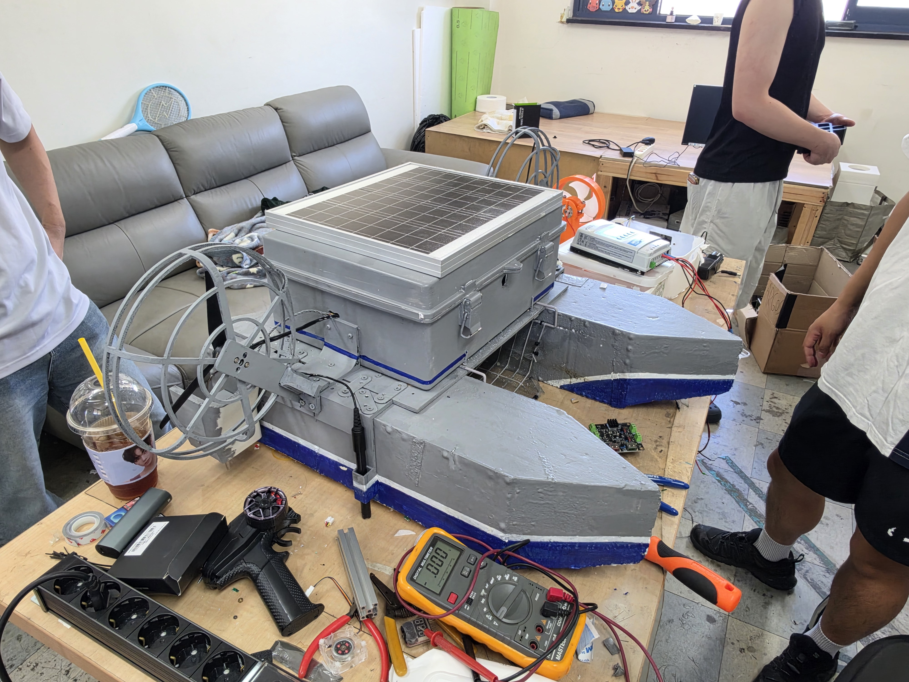
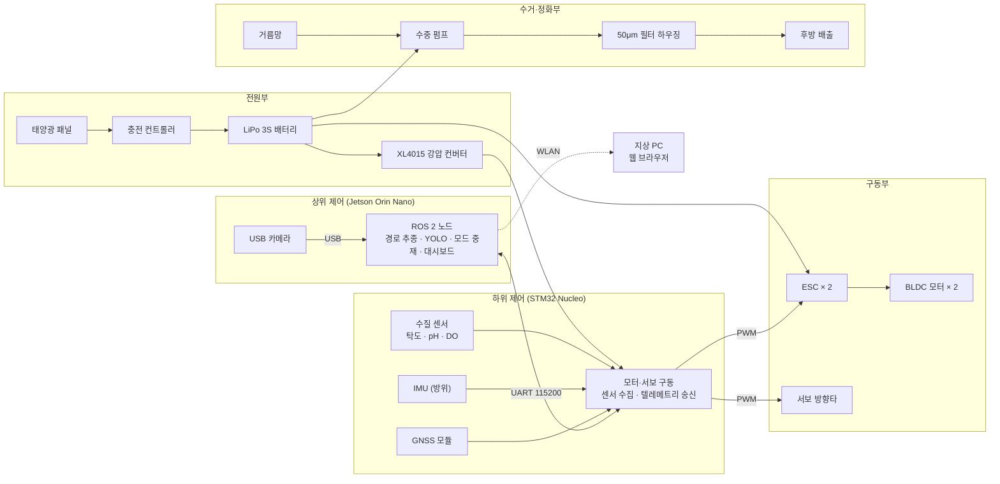
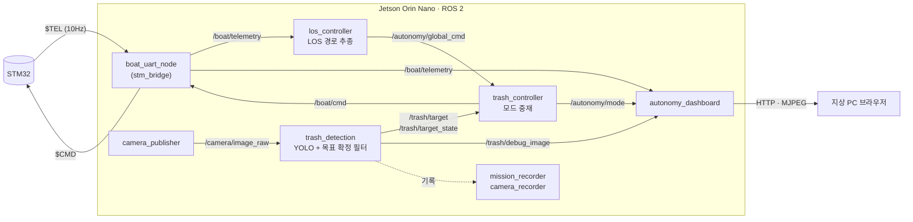
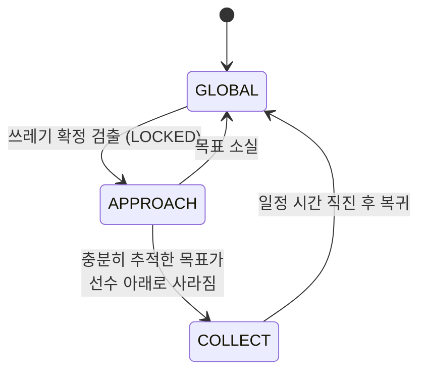

# 🚤 자율주행 수면 정화 로봇 및 실시간 수질 맵핑 로봇

> 2026 한이음 드림업 프로젝트 공모전 · 프로젝트 번호 **26_HC125**

<p align="center">
  
</p>

---

## 💡1. 프로젝트 개요

### 1-1. 프로젝트 소개

- **프로젝트 명** : 자율주행 수면 정화 로봇 및 실시간 수질 맵핑 로봇
- **프로젝트 정의** : 캠퍼스 연못·분수대처럼 사람이 들어가기 어렵고 대형 장비를 투입하기에는 작은 폐쇄형 인공 수역을 대상으로, 사전 경로를 자율 순회하며 부유 쓰레기를 인식·수거하고 위치별 수질(탁도·pH·용존산소)을 측정해 지도 위에 시각화하는 쌍동선 기반 자율 수상 로봇

### 1-2. 개발 배경 및 필요성

- 유동이 거의 없는 인공 호수·연못에서는 부유 쓰레기와 수질 악화가 반복적으로 발생한다. 그러나 이러한 소규모 수역은 대형 청소선을 투입하기에는 작고, 사람이 직접 들어가 작업하기에는 위험하고 비효율적인 **관리 사각지대**에 놓여 있다.
- 기존 관리 방식은 인력이 뜰채나 소형 보트로 쓰레기를 건져내는 수작업에 의존하며, 수질 측정 역시 특정 지점에서 간헐적으로 이루어져 오염의 공간적 분포를 파악하기 어렵다.
- 본 프로젝트는 이러한 공백을 메우기 위해 **자율 주행 + 비전 AI 기반 쓰레기 수거 + 이동형 수질 측정**을 하나의 소형 플랫폼에 통합하고, 캠퍼스 내 실제 수역(호수, 분수대)에서 동작을 검증하는 것을 목표로 한다.

### 1-3. 프로젝트 특장점

- **소규모 폐쇄 수역 특화 플랫폼** : EPS 폰툰 쌍동선 구조로 흘수 약 30mm의 얕은 수역에서도 운용할 수 있으며, 좌우로 넓은 수선면 폭으로 복원 안정성을 확보한다.
- **전역 순회와 국부 접근의 자동 전환** : 평상시에는 GPS 웨이포인트 기반 LOS 경로를 추종하고, YOLO가 쓰레기를 확정 검출하면 즉시 시각 기반 접근 제어로 전환한 뒤 수거가 끝나면 원래 경로로 복귀한다.
- **오검출에 강한 목표 확정 필터** : 단일 프레임 검출을 그대로 쓰지 않고, 여러 프레임에 걸친 신뢰도·위치 연속성 검사(NONE → CANDIDATE → LOCKED → TEMP_LOST)를 통과한 목표만 제어에 사용한다.
- **명령 경로 단일화 설계** : 최종 주행 명령(`/boat/cmd`)은 중재 노드 하나만 발행하도록 설계하여, 여러 제어기가 동시에 명령을 보내는 충돌을 구조적으로 차단한다.
- **이동형 수질 맵핑** : 로봇이 이동하며 측정한 수질 값을 GPS 좌표와 결합해 저장하고, 웹 대시보드에서 수역 지도 위 히트맵으로 표시한다.
- **수거와 정화의 통합** : 선수 거름망으로 부유 쓰레기를 모으고, 수중 펌프와 50μm 필터 하우징으로 물을 물리적으로 여과한 뒤 후방으로 배출한다.

### 1-4. 주요 기능

| 구분 | 기능 | 설명 |
|---|---|---|
| S/W | GPS 웨이포인트 LOS 경로 추종 | 사전 기록한 경로를 로컬 평면 좌표로 변환하고 LOS 유도 법칙과 방위 PD 제어로 추종 |
| S/W | 비전 AI 쓰레기 인식 | USB 카메라 영상을 YOLO로 분석하고 시간 필터로 목표를 확정 |
| S/W | 주행 모드 중재 | GLOBAL(경로 추종) → APPROACH(목표 접근) → COLLECT(수거 직진) 상태 머신 |
| S/W | 실시간 수질 맵핑 대시보드 | 위치·방위·수질 값, 주행 모드, 카메라 영상, 수질 히트맵을 웹 브라우저로 모니터링 |
| S/W | 주행 데이터 기록 | 텔레메트리·명령·검출 결과 CSV 로그, 디버그 영상, 주행 경로 YAML 저장 |
| H/W | 쌍동선 선체 | EPS 폰툰(700×150×150mm) 2개 + 6mm 자작나무 합판 데크, 에폭시 라미네이팅 방수 |
| H/W | 추진·조향 | BLDC 모터 2개(독립 ESC) + 서보 방향타. 방향타가 주 조향, 좌우 추력차가 보조 |
| H/W | 수거·정화 | 거름망 → 수중 펌프 → SUS304 50μm 필터 하우징 → 후방 배출 |
| H/W | 수질 측정 | 탁도·pH·용존산소(DO) 센서 |
| H/W | 전원 | LiPo 3S 배터리 + XL4015 강압 컨버터, 태양광 패널과 충전 컨트롤러로 배터리 보조 충전 |

### 1-5. 기대 효과 및 활용 분야

- **기대 효과** : 소규모 수역의 부유 쓰레기 수거를 무인화하여 관리 인력과 안전사고 위험을 줄이고, 지점 측정에 머물던 수질 관리를 위치 기반 데이터로 전환하여 오염 집중 구역을 직관적으로 파악할 수 있다.
- **활용 분야** : 캠퍼스 연못, 도심 공원 호수, 아파트 단지 내 조경 수역, 분수대, 인공 운하 등 폐쇄형 인공 수역의 상시 관리

### 1-6. 기술 스택

| 구분 | 사용 기술 |
|---|---|
| 상위 제어기 | NVIDIA Jetson Orin Nano, Ubuntu 22.04, ROS 2 Humble |
| 하위 제어기 | STM32 Nucleo (모터·서보 구동, 센서 수집) |
| 언어 | Python 3 (ROS 2 노드), C (STM32 펌웨어) |
| AI / 비전 | Ultralytics YOLO, PyTorch(CUDA), OpenCV, cv_bridge |
| 통신 | UART 115200bps (체크섬 포함 텍스트 패킷), WLAN |
| 대시보드 | Python HTTP 서버 + HTML/JavaScript, MJPEG 영상 스트림 |
| 설계 | NX, Autodesk Inventor, Fusion 360 / Bambu Lab A1 (PETG 3D 프린팅) |
| 형상관리 | Git, GitHub |

---

## 💡2. 팀원 소개

| **멘티1** | **멘티2** | **멘티3** | **멘티4** | **멘티5** | **멘토** |
|:---:|:---:|:---:|:---:|:---:|:---:|
| • 팀장<br>• 프로젝트 총괄 | • 기계·구조 설계<br>• 선체·방수 제작 | • 구조 설계<br>• 문서 작성 | • 자율 항법(LOS)<br>• 비전 AI(YOLO)<br>• STM32 제어<br>• 웹 대시보드 | • 정화 시스템<br>• 펌프·여과 설계 | • 프로젝트 멘토<br>• 기술 자문 |

---

## 💡3. 시스템 구성도

### 3-1. H/W 구성도



### 3-2. S/W 구성도 (ROS 2 노드)



### 3-3. 주행 모드 흐름



| 모드 | 동작 |
|---|---|
| **GLOBAL** | 사전 기록한 웨이포인트 경로를 LOS 방식으로 추종하며 수역을 순회 |
| **APPROACH** | 영상 속 목표의 좌우 위치 오차로 조향, 목표 크기에 따라 감속하며 접근 |
| **COLLECT** | 목표가 선수 아래로 들어가 보이지 않게 되면 일정 시간 저속 직진하여 거름망으로 수거 |

### 3-4. Jetson ↔ STM32 통신 프로토콜

| 방향 | 패킷 형식 | 주기 |
|---|---|---|
| STM32 → Jetson | `$TEL,<위도>,<경도>,<탁도>,<pH>,<방위>,<DO>,<GPS fix>*<XOR>` | 10Hz |
| Jetson → STM32 | `$CMD,<조향각 -180~180>,<출력 0~10>*<XOR>` | 명령 발생 시 |

---

## 💡4. 작품 소개영상

[](https://youtu.be/HhWbZlH-5DQ)

---

## 💡5. 핵심 소스코드

### 5-1. LOS 경로 추종 – 목표 방위 계산 및 방향타 명령 생성

현재 추종 중인 웨이포인트 구간에 대한 횡방향 오차를 구하고, look-ahead 거리를 이용해 목표 방위를 계산한 뒤 방위 PD 제어와 변화율 제한을 거쳐 방향타 명령을 만든다.
([`los_controller.py`](boat_ws/src/boat_autonomy/boat_autonomy/los_controller.py))

```python
path_heading = math.atan2(segment_dy, segment_dx)          # 경로 방향각 γp
dx = x - x1
dy = y - y1
cross_track_error = (                                       # 횡방향 오차 ye
    -dx * math.sin(path_heading) + dy * math.cos(path_heading)
)
desired_heading = wrap_angle(                               # LOS 목표 방위 ψd
    path_heading - math.atan2(cross_track_error, self.lookahead)
)
heading_error = wrap_angle(desired_heading - self.heading)

rudder_target = clamp(                                      # 방위 PD 제어
    -self.heading_kp * math.degrees(heading_error)
    + self.heading_kd * math.degrees(self.yaw_rate),
    -self.max_rudder_deg,
    self.max_rudder_deg,
)
max_rudder_change = self.max_rudder_rate_deg_s * rudder_dt  # 방향타 변화율 제한
rudder_deg = clamp(
    rudder_target,
    self.last_rudder_deg - max_rudder_change,
    self.last_rudder_deg + max_rudder_change,
)
```

### 5-2. 주행 모드 중재 – 경로 추종과 쓰레기 접근의 자동 전환

LOS 명령과 비전 검출 결과를 함께 받아 하나의 최종 명령만 STM32로 보낸다.
([`trash_controller.py`](boat_ws/src/boat_autonomy/boat_autonomy/trash_controller.py))

```python
def control_loop(self):
    now = time.monotonic()
    target = self._fresh_target(now)
    if self.mode == self.GLOBAL:
        if target is not None:                        # 쓰레기 확정 → 접근
            self._set_mode(self.APPROACH)
    elif self.mode == self.APPROACH:
        if (self.target_filter_state == 'TEMP_LOST'
                and self.qualified_target_lost):      # 선수 아래로 진입 → 수거
            self.collection_started_at = now
            self._set_mode(self.COLLECT)
        elif target is None:                          # 목표 소실 → 경로 복귀
            self._set_mode(self.GLOBAL)
    elif self.mode == self.COLLECT:
        if now - self.collection_started_at >= self.collection_drive_duration:
            self._set_mode(self.GLOBAL)               # 수거 직진 종료 → 경로 복귀

    if self.mode == self.GLOBAL:
        self._publish_global(now)                     # LOS 명령 전달
    elif self.mode == self.APPROACH and target is not None:
        self._publish_approach(target, now)           # 시각 기반 접근 제어
    elif self.mode == self.COLLECT:
        self._publish(0.0, self.collection_output)    # 저속 직진
```

---

## 📁 저장소 구조

```
26_HC125/
└── boat_ws/                        # ROS 2 워크스페이스 (Jetson Orin Nano)
    └── src/boat_autonomy/
        ├── boat_autonomy/          # ROS 2 노드 소스코드
        │   ├── stm_bridge.py         # Jetson ↔ STM32 UART 통신
        │   ├── los_controller.py     # LOS 경로 추종
        │   ├── trash_detection.py    # YOLO 쓰레기 검출
        │   ├── target_filter.py      # 검출 목표 확정 필터
        │   ├── trash_controller.py   # 주행 모드 중재
        │   ├── autonomy_dashboard.py # 웹 대시보드 서버
        │   └── ...                   # 카메라·로그 기록 노드
        ├── config/                 # 파라미터, 웨이포인트 경로
        ├── launch/                 # 통합 실행 launch 파일
        ├── web/                    # 대시보드 HTML, 수역 지도
        └── tools/                  # 영상 기반 검출 검증 도구
```

## ▶️ 실행 방법 (Jetson)

```bash
cd ~/boat_ws
colcon build --packages-select boat_autonomy
source install/setup.bash
ros2 launch boat_autonomy trash_autonomy.launch.py
```

> 설정 파일의 경로(`/home/rodin/...`)와 YOLO 가중치(`best.pt`)는 Jetson 환경 기준이다. 가중치 파일은 용량 문제로 저장소에 포함하지 않았다.
